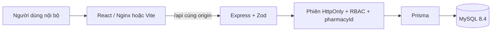
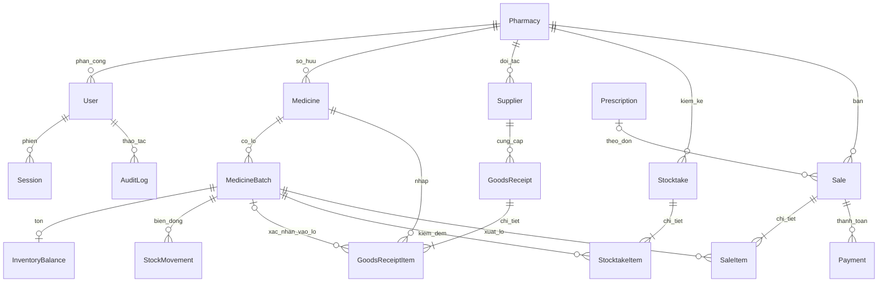

# Kiến trúc và quyết định thiết kế

## Thành phần

Frontend không giữ token hoặc vai trò trong localStorage. Mọi quyền truy cập được xác định từ phiên trên máy chủ. Vite và Nginx proxy API cùng origin, tránh cấu hình cookie cross-site. Backend không phát hành token quyền tin cậy cho client; mỗi request đọc user/nhà thuốc hiện tại. Phiên tồn tại 8 giờ, cookie HttpOnly/SameSite=Lax, token ngẫu nhiên 32 byte và chỉ SHA-256 của token được lưu trong DB. Mật khẩu dùng scrypt và salt ngẫu nhiên riêng. Login có giới hạn thử sai, so hash giả khi email không tồn tại; request ghi phải có `Origin` đúng `APP_ORIGIN`.

Khi đổi quyền, mật khẩu hoặc khóa người dùng, phiên của họ bị thu hồi. Khi nhà thuốc ngừng hoạt động, request tiếp theo của tài khoản thuộc nhà thuốc bị chặn. Admin không được tự khóa hoặc tự bỏ quyền quản trị. Log không in token/mật khẩu; audit chỉ ghi actor, hành động, thực thể, ID và thời điểm, trong cùng transaction với thao tác ghi.

## Mô hình tenant

Giai đoạn 1: một user có một `Role` enum và tối đa một `pharmacyId`. Admin không thuộc nhà thuốc; Manager có thể chưa được gán để Admin phân công sau. Nhân viên bắt buộc thuộc nhà thuốc. Manager chưa được gán không thể đăng nhập. Nhiều người quản lý có thể cùng phụ trách một nhà thuốc. Thay phân công thực hiện ở màn hình người dùng; form nhà thuốc có thể gán thêm quản lý chưa thuộc nhà thuốc khác, không tự gỡ quản lý hiện tại.

API nghiệp vụ không nhận `pharmacyId` để chọn tenant. Middleware lấy nó từ user đã xác thực. Truy vấn sửa dùng `id + pharmacyId`; không tìm thấy trong phạm vi trả 404. Manager chỉ xem/sửa tài khoản Sales và Inventory cùng nhà thuốc, không xem hoặc thay đổi tài khoản Manager/Admin qua API nhân viên. Admin quản lý nhà thuốc/tài khoản, không vào POS hay API danh mục của tenant bằng tài khoản Admin.

DB dùng các unique key `(id, pharmacyId)` và foreign key kết hợp ở lô, tồn, chứng từ, dòng chứng từ, thanh toán, kiểm kê; vì vậy không thể liên kết lô của nhà thuốc B với phiếu của A. `StockMovement.reference` hiện là mã nguồn nghiệp vụ và có unique `(pharmacyId, reference, batchId, type)` để chuẩn bị chống ghi lặp; trước Phase 2 cần chuẩn hóa liên kết nguồn và idempotency cho toàn giao dịch. Người tạo chứng từ lấy từ phiên, không do client gửi.

## Mô hình dữ liệu chính

`InventoryBalance` theo từng lô, không dùng tổng tồn thuốc để thay thế lô. `Medicine.salePrice`, `MedicineBatch.purchasePrice`, tổng chứng từ và thanh toán dùng `DECIMAL(14,2)`. Đơn vị tính ở Phase 1 là đơn vị tồn cơ sở duy nhất, chưa quy đổi hộp/vỉ/viên; dòng nhập lấy đơn vị từ danh mục và hiển thị cho người lập. Chứng từ và dòng bán có snapshot giá, tên/đơn vị; hàng cũ không xóa cứng. Danh mục/người dùng/nhà thuốc có `active`; lô có `AVAILABLE`, `QUARANTINED`, `RECALLED`; chứng từ có `DRAFT`, `CONFIRMED`, `CANCELLED`. `version` trên balance dành cho kiểm soát đồng thời Phase 2, chưa được dùng để bán thật.

Ngày hạn dùng và ngày nhập là `DATE`, thời điểm giao dịch là DateTime. Phân tích theo ngày dùng múi giờ `Asia/Ho_Chi_Minh`. FEFO hiện dùng chính sách bảo thủ: chỉ lô có ngày hết hạn **sau ngày hiện tại**, trạng thái AVAILABLE, tồn dương và thuốc active. Lô hết hạn hôm nay cũng không được đề xuất. Nếu lô gần nhất không đủ số lượng, xem trước phân bổ phần còn lại sang lô đủ điều kiện tiếp theo. Không mutate dữ liệu tồn ở trình duyệt. Phase 2 phải xác thực lại FEFO và khóa tồn ở server, không tin kết quả client.

## Ranh giới hoàn thiện

API quản lý và phiếu nhập nháp đã ghi MySQL thật. Tất cả chứng từ CONFIRMED hiện có là dữ liệu seed `isDemo=true`, có các biến động khớp số tồn. Seed idempotent, không phá dữ liệu đã có. POS và kiểm kê giữ dữ liệu trong state của trang, mất khi reload hoặc rời trang; không tạo chứng từ giả. Các API xác nhận nhập/bán/kiểm kê chưa triển khai trả 501. Báo cáo tổng hợp trực tiếp các chứng từ trong DB, gắn nhãn DEMO nếu có bản ghi mẫu. Thẻ tồn trên tab tổng quan là tồn hiện tại. Tab Nhập–Xuất–Tồn riêng tổng hợp StockMovement để tính tồn đầu/cuối theo kỳ; không dùng InventoryBalance hiện tại làm tồn cuối quá khứ.

Danh sách danh mục tải toàn bộ tenant trong Phase 1; phân trang/tìm kiếm thực hiện tại UI. Lịch sử bán giới hạn 500 chứng từ, phiếu nhập 100 phiếu gần nhất; báo cáo giới hạn 366 ngày. Đây là giới hạn của giai đoạn khung, cần server pagination và xử lý tải lớn ở Phase 2.

## Đối chiếu với ảnh Use Case

| Điểm trong sơ đồ                                                                         | Quyết định triển khai / cập nhật báo cáo                                                                                                                      |
| ---------------------------------------------------------------------------------------- | ------------------------------------------------------------------------------------------------------------------------------------------------------------- |
| UC-20 chưa có trong hình                                                                 | Bổ sung Manage Pharmacies cho Admin theo yêu cầu chữ; giữ số UC-01..UC-19                                                                                     |
| Login / Admin Login / Pharmacy Manager Login / Sales Staff Login / Inventory Staff Login | Dùng một trang và API xác thực chung; phân hướng sau login theo role                                                                                          |
| Các quan hệ `«extend»` từ nghiệp vụ đến login                                            | Hiểu đăng nhập là điều kiện trước của nghiệp vụ; không tạo các trang login con. Nên sửa UML để tránh mô tả chức năng nghiệp vụ như một nhánh mở rộng xác thực |
| Manage User liên kết với User tổng quát                                                  | Theo yêu cầu chữ, quản lý toàn hệ thống chỉ Admin; Manager chỉ nhân viên của mình; User chỉ xem tài khoản và đăng nhập/đăng xuất                              |
| Customer liên kết với Sell Prescription / OTC                                            | Customer là người mua tại quầy; Sales Staff thao tác POS, không có tài khoản khách hoặc giao diện shopping                                                    |
| Sell Prescription / OTC kế thừa Sell Medicines                                           | Chung POS, chế độ OTC/theo đơn và trường thông tin đơn thuốc; chưa phát sinh giao dịch bán thật                                                               |
| Monitor Inventory của Manager, Search Medicines and Check Stock của kho/bán              | Chung trang tồn read-only, phạm vi và sidebar thay đổi theo role                                                                                              |

## Nguồn tham khảo kỹ thuật

Cấu trúc frontend dùng [Vite](https://vite.dev/guide/) và mô hình thành phần cục bộ [shadcn/ui cho Vite](https://ui.shadcn.com/docs/installation/vite). Các thành phần Button/Dialog được tùy biến dựa trên Radix và CVA, có `components.json` để mở rộng. Không dùng nền tảng hosting Sites vì yêu cầu là repository cục bộ, MySQL và Docker; không triển khai hay push bên ngoài.

## Mở rộng quản lý theo form tham khảo

Manager có quyền đọc lịch sử nhập, bán và hạn dùng, đồng thời giữ nguyên quyền ghi phiếu nhập của Inventory và POS của Sales. Trang `/lookup` là tra cứu chung của cả ba vai trò; `/inventory` chuyển hướng để giữ tương thích URL cũ. Nút cấp vai trò gọi API PATCH riêng với payload tối thiểu, kiểm tra nhân viên cùng cơ sở trong transaction, thu hồi session và ghi audit. Metadata mã vạch có unique `(pharmacyId, barcode)`; null cho phép thuốc chưa có mã. Các form không bổ sung VAT, công nợ, tích điểm hoặc quy đổi nhiều đơn vị ở giai đoạn 1.

Xuất CSV dùng các bản ghi đúng bộ lọc, UTF-8 BOM và xử lý chuỗi công thức. Bản in dùng React portal và CSS print, gồm tất cả dòng của chứng từ/báo cáo; không phụ thuộc trang hiện tại trong DataTable. Không dùng HTML ghép từ đầu vào để tạo bản in. Nguồn mẫu/nháp được ghi rõ ở footer.
