# 2.6 – Phác thảo giao diện người dùng

Ứng dụng chạy thật với React, Express và MySQL 8.4, dữ liệu được tạo bởi seed. Các ảnh là screenshot Playwright, không dùng ảnh AI. Kích thước viewport và PNG là **1440 × 900**, locale vi-VN và múi giờ Asia/Ho_Chi_Minh. Tài khoản dùng đúng vai trò cho từng hình; không ghi mật khẩu hoặc cookie vào ảnh.

## Hình 2.9 – Giao diện quản lý nhà thuốc

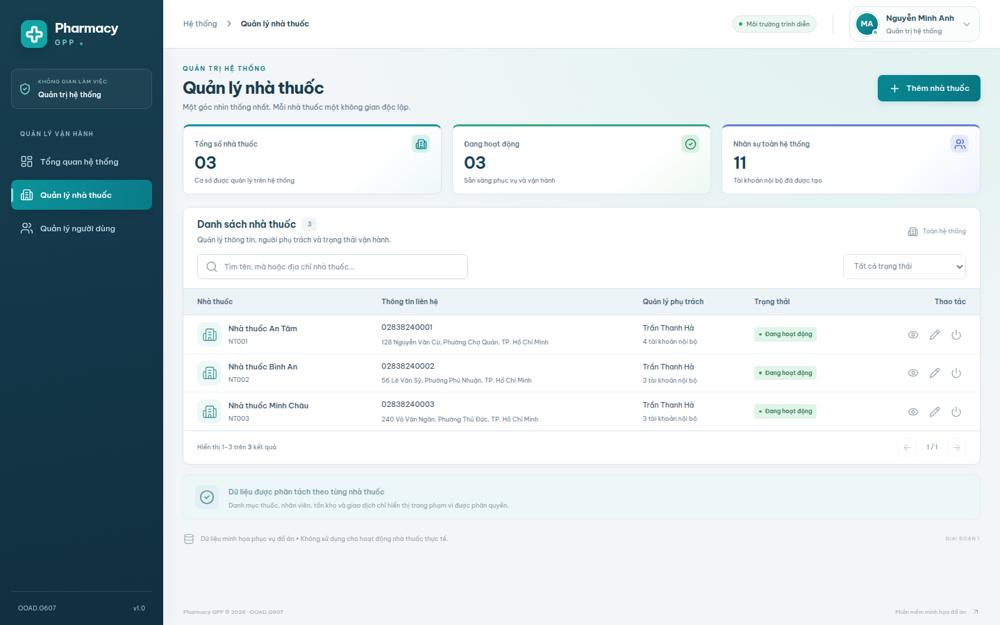

- **Use Case:** UC-20 Manage Pharmacies; liên quan UC-14 Manage User.
- **Actor:** Admin.
- **Mục đích:** Quản lý các nhà thuốc độc lập và tình trạng vận hành.

Giao diện cung cấp danh sách nhà thuốc cùng mã, thông tin liên hệ, người quản lý và trạng thái hoạt động. Các thẻ phía trên tóm tắt tổng số cơ sở và tài khoản trong hệ thống. Admin có thể tìm kiếm, lọc, xem chi tiết, thêm, chỉnh sửa và kích hoạt hoặc ngừng nhà thuốc. Form cho phép gán thêm người quản lý phù hợp; thay đổi phân công được thực hiện tại màn hình người dùng. Các thao tác này lưu dữ liệu thật vào MySQL và có audit; ngừng nhà thuốc chặn quyền truy cập của tài khoản thuộc nhà thuốc. Nội dung trong ảnh là bộ dữ liệu demo của đồ án.

## Hình 2.10 – Giao diện quản lý danh mục thuốc và giá

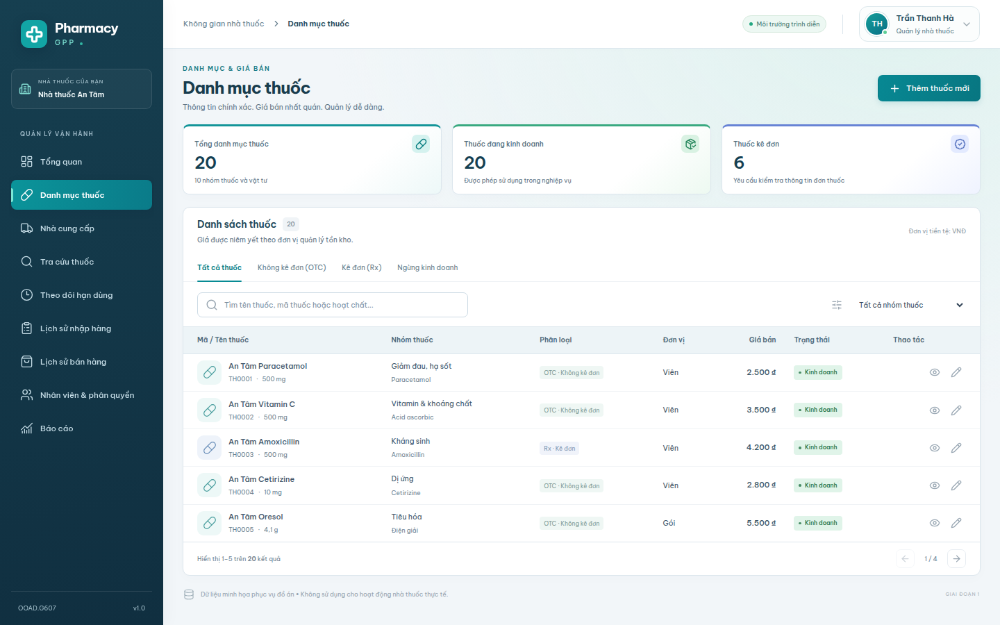

- **Use Case:** UC-15 Manage Medicines and Prices.
- **Actor:** Pharmacy Manager.
- **Mục đích:** Quản lý thông tin thuốc và giá bán trong phạm vi nhà thuốc.

Màn hình tổ chức thuốc theo mã, tên, nhóm, phân loại kê đơn, đơn vị, giá và trạng thái kinh doanh. Người quản lý có thể tìm theo tên, mã hoặc hoạt chất và lọc nhóm hoặc phân loại thuốc. Nút thêm và chỉnh sửa mở form có kiểm tra dữ liệu bắt buộc. Giá sử dụng kiểu DECIMAL ở database, không dùng FLOAT để lưu tiền. Các thay đổi danh mục được lưu thật và không ảnh hưởng danh mục của nhà thuốc khác. Tên thuốc trong bộ seed chỉ phục vụ trình diễn, không phải nguồn tư vấn chuyên môn.

## Hình 2.11 – Giao diện lập phiếu nhập thuốc

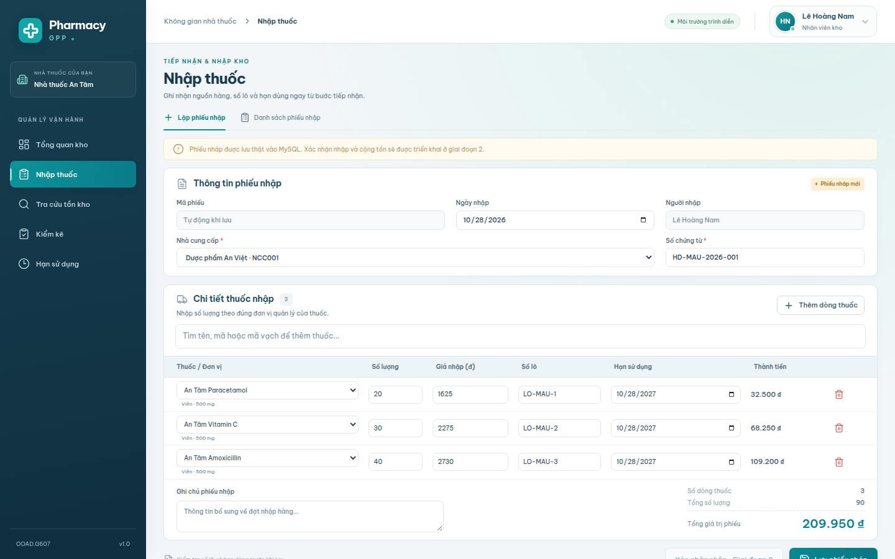

- **Use Case:** UC-06 Receive Medicines.
- **Actor:** Inventory Staff.
- **Mục đích:** Ghi thông tin tiếp nhận, lô và hạn dùng để lập phiếu nhập nháp.

Phần đầu hiển thị mã phiếu tự động, ngày nhập, người nhập, nhà cung cấp và số chứng từ. Bảng chi tiết cho phép chọn nhiều thuốc, thêm hoặc xóa dòng và nhập số lượng, giá, lô, hạn dùng. Đơn vị được lấy từ danh mục để thống nhất với đơn vị tồn. Tổng giá trị cập nhật trên giao diện và được tính lại bằng Decimal ở backend khi lưu. Lưu nháp tạo chứng từ DRAFT thật trong MySQL nhưng không tăng tồn. Nút xác nhận nhập bị vô hiệu hóa và API xác nhận trả 501 vì nghiệp vụ cộng tồn thuộc giai đoạn 2.

## Hình 2.12 – Giao diện tra cứu thuốc và tồn kho

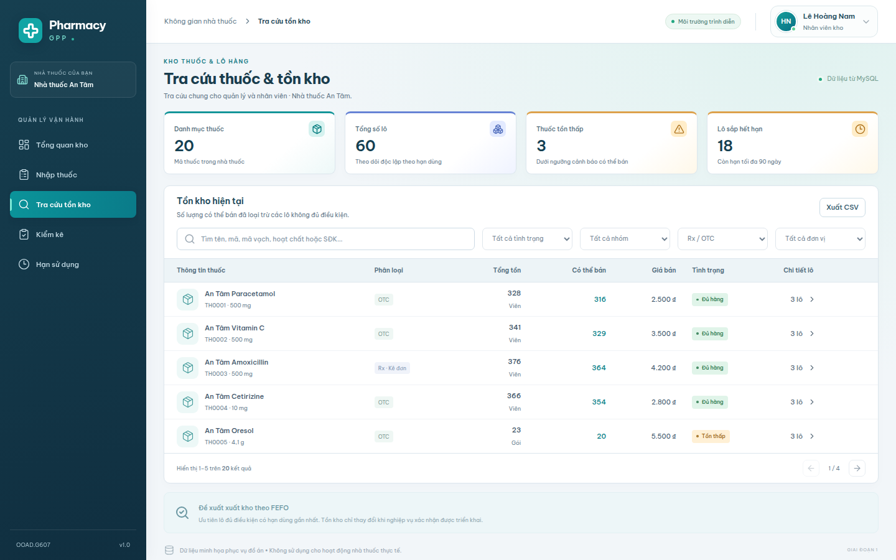

- **Use Case:** UC-09 Search Medicines and Check Stock; dùng chung dữ liệu với UC-17 Monitor Inventory.
- **Actor trong ảnh:** Inventory Staff; Pharmacy Manager và Sales Staff có quyền đọc trang tương ứng.
- **Mục đích:** Kiểm tra tồn theo thuốc và mở chi tiết từng lô.

Các thẻ thống kê thể hiện số thuốc, số lô, thuốc tồn thấp và lô sắp hết hạn. Bảng phân biệt tổng tồn vật lý với số lượng có thể bán, kèm giá và trạng thái. Khi mở chi tiết, người dùng thấy số lô, ngày nhập, hạn dùng, số lượng còn và tình trạng lô. Lô hết hạn, hết hạn hôm nay, cách ly và thu hồi không được tính vào lượng có thể bán. Dữ liệu được đọc trực tiếp từ MySQL và giới hạn theo nhà thuốc của phiên đăng nhập. Đây là chức năng tra cứu thật trên bộ tồn demo, không tự tạo biến động tồn.

## Hình 2.13 – Giao diện bán thuốc tại quầy

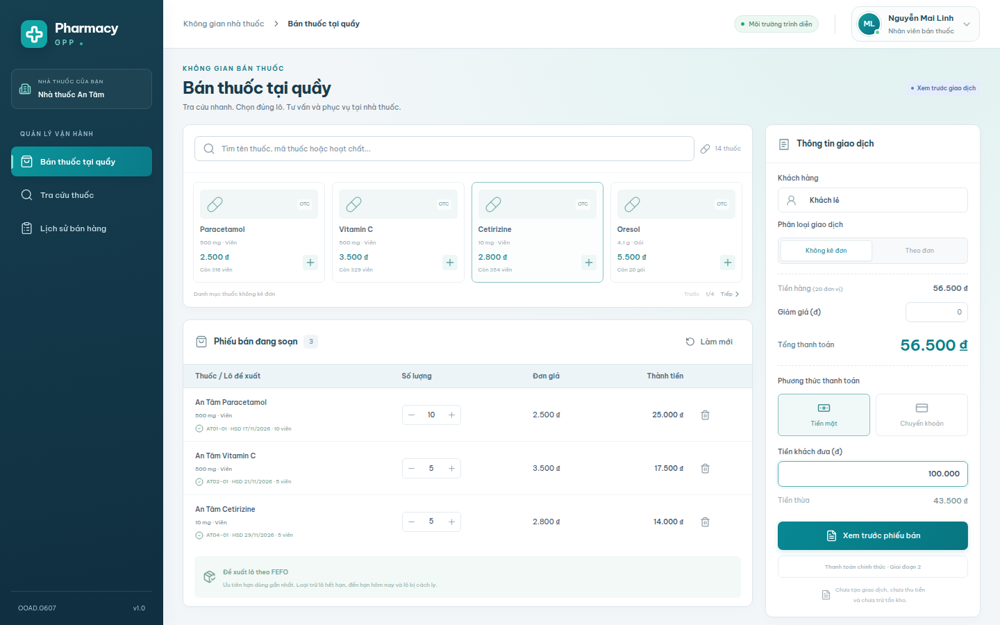

- **Use Case:** UC-10 Sell Medicines, UC-11 Sell Prescription Medicines, UC-12 Sell OTC Medicines, UC-09 tra cứu thuốc.
- **Actor:** Sales Staff; Customer chỉ mua trực tiếp tại quầy.
- **Mục đích:** Soạn và xem trước phiếu bán trong một POS thống nhất.

Khu vực bên trái hỗ trợ tìm thuốc, thêm vào phiếu và điều chỉnh số lượng. Mỗi dòng hiển thị lô được đề xuất theo FEFO, có thể chia sang nhiều lô đủ điều kiện khi cần. Khu vực bên phải thể hiện khách hàng, loại giao dịch, tiền hàng, giảm giá, tổng tiền và phương thức thanh toán minh họa. Khi chọn theo đơn và có thuốc Rx, màn hình yêu cầu mã đơn, ngày kê, người kê và trạng thái kiểm tra trước khi xem trước. Giai đoạn 1 chỉ tính toán và hiển thị bản xem trước; không tạo hóa đơn, lưu đơn thuốc, xác nhận ngân hàng hoặc trừ tồn. Ảnh minh họa phiếu OTC với ba thuốc, không phải giao dịch bán hoàn tất.

## Hình 2.14 – Giao diện báo cáo

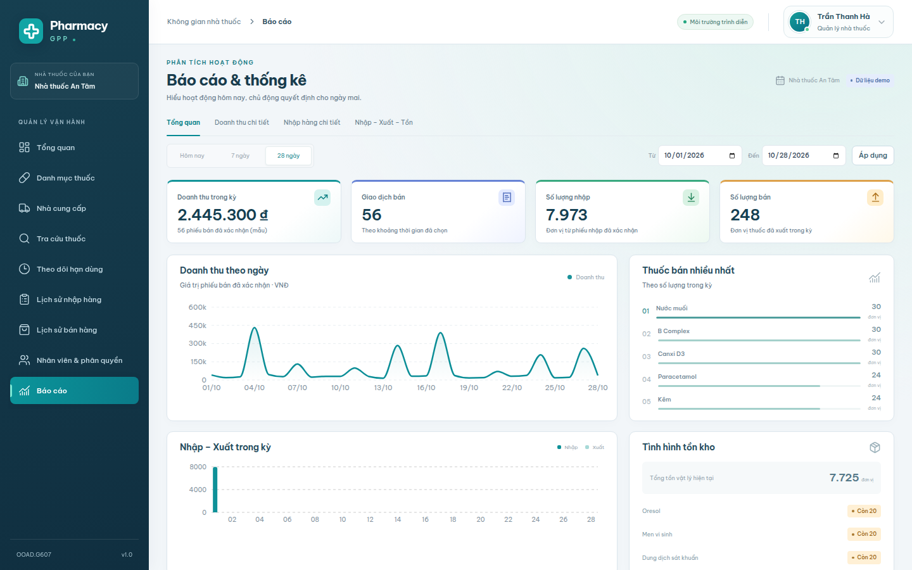

- **Use Case:** UC-19 View Reports; liên quan UC-17 Monitor Inventory.
- **Actor:** Pharmacy Manager.
- **Mục đích:** Theo dõi doanh thu, nhập/xuất, thuốc bán nhiều và cảnh báo tồn.

Người quản lý chọn hôm nay, 7 ngày, 28 ngày hoặc một khoảng thời gian cụ thể. Các thẻ thể hiện doanh thu, số giao dịch, lượng nhập và lượng bán theo bộ lọc. Biểu đồ doanh thu, nhập/xuất và danh sách thuốc bán nhiều giúp minh họa kết quả hoạt động. Các số liệu được tổng hợp bằng API từ chứng từ trong MySQL, không hardcode trên frontend. Trong ảnh, toàn bộ giao dịch nguồn là dữ liệu seed demo và có nhãn thể hiện rõ; tồn ở phần cảnh báo là tồn hiện tại, không phải tồn cuối kỳ lịch sử. Báo cáo chưa thay thế quy trình kế toán hoặc báo cáo nghiệp vụ chính thức.

## Chụp lại

Chạy ứng dụng và migrate/seed trước theo README gốc. Ở terminal khác tại root dự án:

```bash
npx playwright install chromium
npm run screenshots
```

Hoặc dùng Chrome có sẵn:

```bash
PLAYWRIGHT_CHROME_PATH=/usr/bin/google-chrome npm run screenshots
```

Để chụp bản Docker: `E2E_BASE_URL=http://localhost:8080 PLAYWRIGHT_CHROME_PATH=/usr/bin/google-chrome npm run screenshots`. Nếu đổi mật khẩu demo khi seed, truyền `DEMO_PASSWORD` vào môi trường chạy test, không ghi mật khẩu vào mã test hoặc ảnh. Script ở `e2e/report.spec.ts`; hình ghi đúng tên trong `images/`. Font được phục vụ cục bộ, script đợi font và dữ liệu, kiểm tra không có lỗi trang trước khi chụp.

## Hình 2.15 – Tổng quan quản lý cơ sở

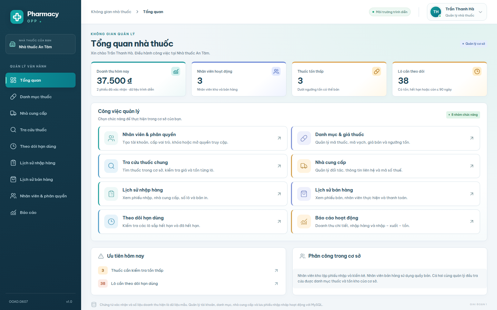

**Actor:** Pharmacy Manager. **Use Case:** UC-05, UC-15 đến UC-19 và các chức năng tra cứu. Trang tổng quan tập hợp tám nhóm chức năng để người quản lý nhận biết đầy đủ phạm vi công việc. Các thẻ hiển thị doanh thu hôm nay, số nhân viên hoạt động, thuốc tồn thấp và lô cần theo dõi. Mỗi thẻ chức năng dẫn tới màn hình thực hiện tương ứng. Phần ưu tiên giúp chuyển nhanh sang tra cứu tồn và hạn dùng. Dữ liệu lấy qua API trong cơ sở; doanh thu minh họa được ghi rõ là dữ liệu mẫu.

## Hình 2.16 – Quản lý nhân viên và quyền theo vai trò

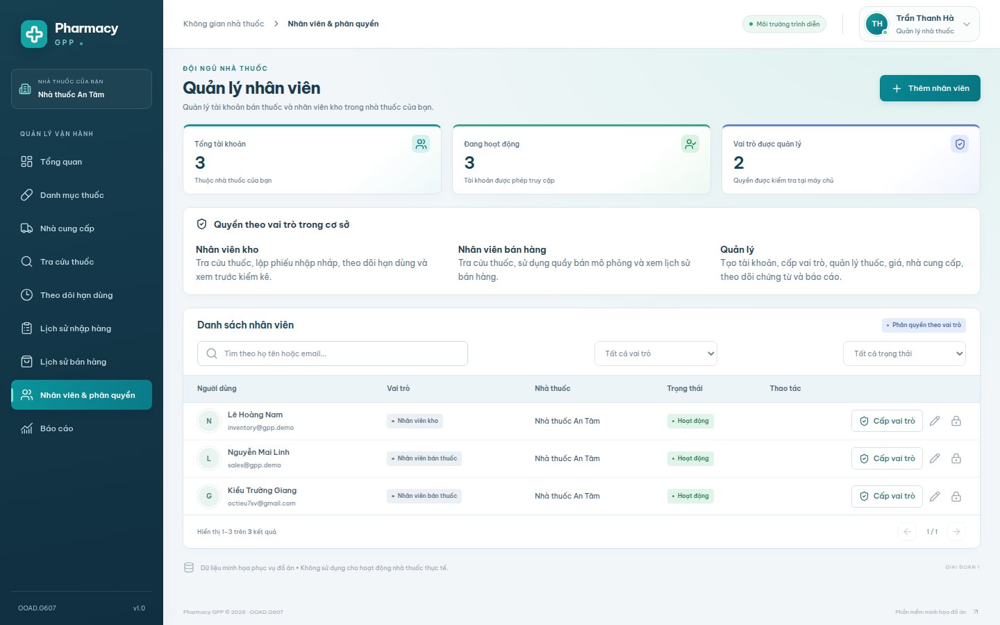

**Actor:** Pharmacy Manager. **Use Case:** UC-18 Manage Staff Accounts. Màn hình cho phép thêm tài khoản với mật khẩu và vai trò, chỉnh sửa thông tin hoặc khóa/mở khóa nhân viên. Bảng mô tả quyền giúp phân biệt nhân viên kho, nhân viên bán thuốc và quản lý. Danh sách có tìm kiếm, lọc vai trò và lọc trạng thái. Quản lý chỉ thấy nhân viên thuộc cơ sở mình; ràng buộc này được kiểm tra tại backend. Thao tác quản lý tài khoản được lưu thật vào MySQL.

## Hình 2.17 – Cấp vai trò cho nhân viên

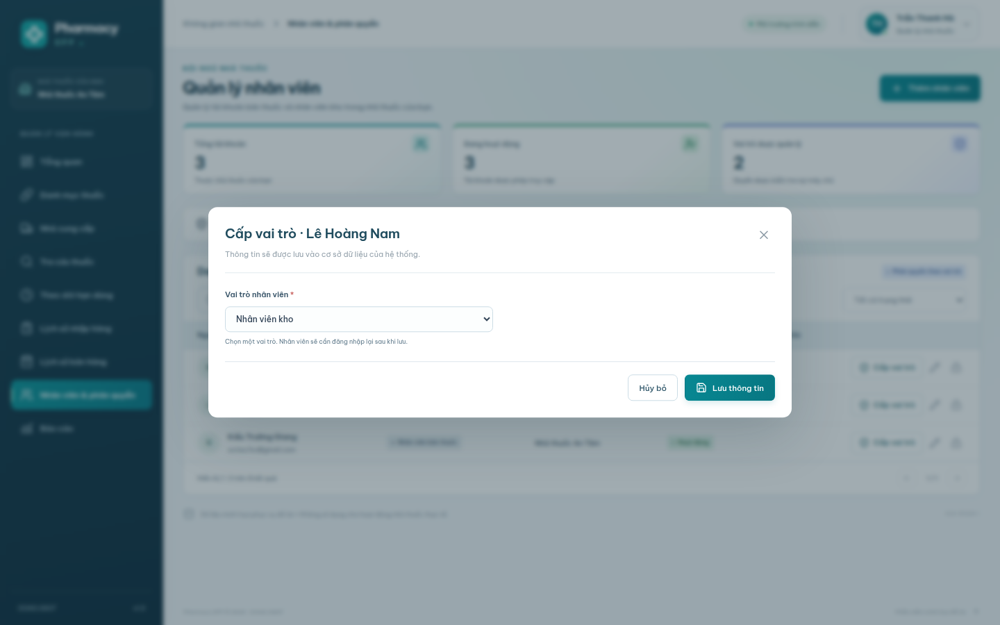

**Actor:** Pharmacy Manager. **Use Case:** UC-18 Manage Staff Accounts. Nút Cấp vai trò mở form nhỏ dành riêng cho việc phân công nhân viên. Người quản lý chọn một trong hai vai trò nhân viên kho hoặc nhân viên bán thuốc. Form không cho cấp quyền Admin hoặc Manager. Khi lưu, backend kiểm tra phạm vi cơ sở, đổi vai trò, thu hồi phiên cũ và ghi nhật ký trong cùng giao dịch. Nhân viên cần đăng nhập lại để nhận menu và quyền mới; ảnh chỉ mở form, chưa thay đổi vai trò mẫu.

## Hình 2.18 – Chi tiết thuốc trong trang tra cứu chung

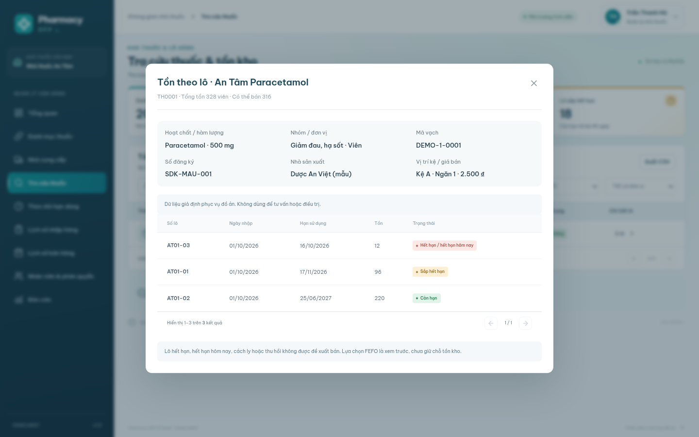

**Actor trong ảnh:** Pharmacy Manager; dùng chung với Inventory Staff và Sales Staff. **Use Case:** UC-09 và UC-17. Người dùng tìm thuốc bằng mã vạch mẫu và mở chi tiết lô. Form hiển thị hoạt chất, hàm lượng, nhóm, mã vạch, số đăng ký, nhà sản xuất, vị trí kệ và giá bán. Danh sách bên dưới cho biết ngày nhập, số lượng, hạn dùng và trạng thái từng lô. Tổng tồn và số lượng có thể bán được phân biệt rõ. Tất cả vai trò chỉ thấy thuốc của cơ sở mình, không có quyền sửa danh mục từ trang tra cứu.

## Hình 2.19 – Báo cáo doanh thu chi tiết

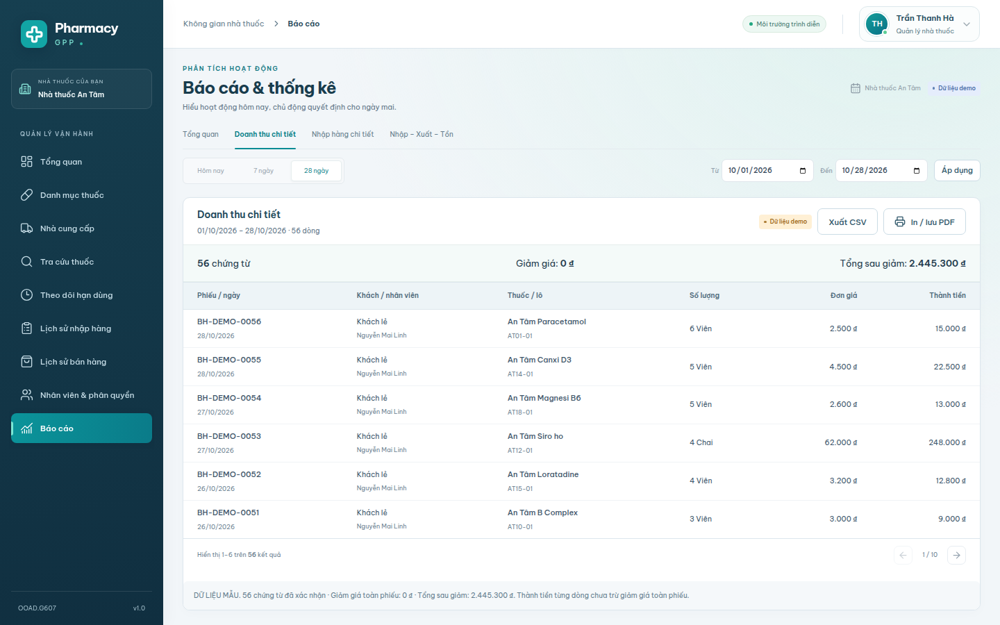

**Actor:** Pharmacy Manager. **Use Case:** UC-19 View Reports. Báo cáo liệt kê từng dòng thuốc trong phiếu bán đã xác nhận theo khoảng ngày. Mỗi dòng cho biết mã phiếu, ngày, khách hàng, nhân viên, thuốc, lô, số lượng, đơn giá và thành tiền. Phần tổng hợp hiển thị số chứng từ, giảm giá toàn phiếu và tổng sau giảm giá. Giảm giá không bị cộng lặp theo số dòng thuốc. Người dùng có thể xuất CSV hoặc in/lưu PDF toàn bộ kết quả; ảnh dùng dữ liệu seed có nhãn Demo.

## Hình 2.20 – Báo cáo nhập–xuất–tồn theo kỳ

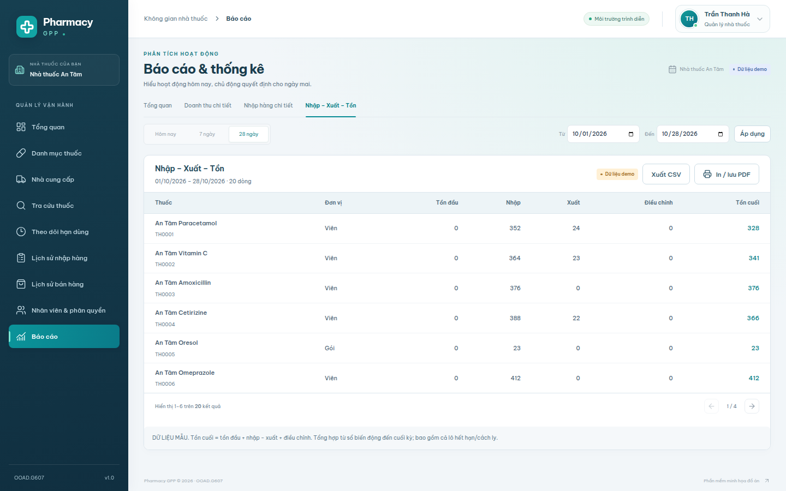

**Actor:** Pharmacy Manager. **Use Case:** UC-17, UC-19. Bảng báo cáo thể hiện tồn đầu, nhập, xuất, điều chỉnh và tồn cuối theo từng thuốc. Dữ liệu được tổng hợp từ sổ biến động StockMovement trước và trong kỳ báo cáo. Công thức tồn cuối được giải thích ngay dưới bảng để thuận tiện thuyết trình. Đây là tồn vật lý theo sổ, bao gồm lô hết hạn/cách ly, không đồng nghĩa lượng có thể bán. Báo cáo có xuất CSV, bản in và nhãn dữ liệu minh họa, phù hợp phạm vi giai đoạn 1.

## Hình 2.21 – Menu tài khoản ở góc phải

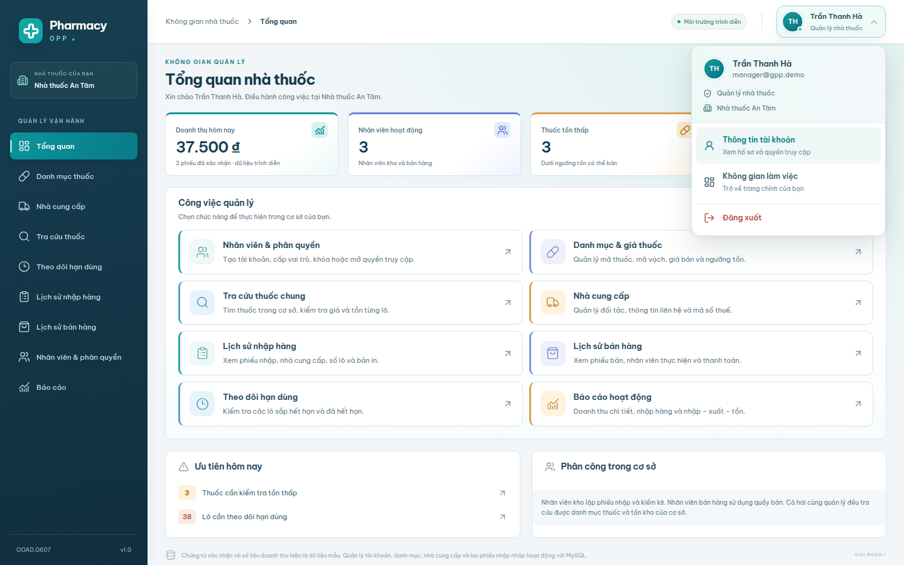

**Actor trong ảnh:** Pharmacy Manager; menu dùng chung cho các vai trò. **Use Case:** UC-01 Login và thông tin phiên. Bấm avatar mở menu hiển thị họ tên, email, vai trò và nhà thuốc. Người dùng có thể mở hồ sơ, trở về không gian làm việc hoặc đăng xuất. Menu hỗ trợ phím mũi tên, Escape và đóng khi bấm ra ngoài. Thao tác đăng xuất hủy phiên thật ở backend. Hình minh họa giao diện có độ tương phản cao hơn với thanh điều hướng xanh đậm.
